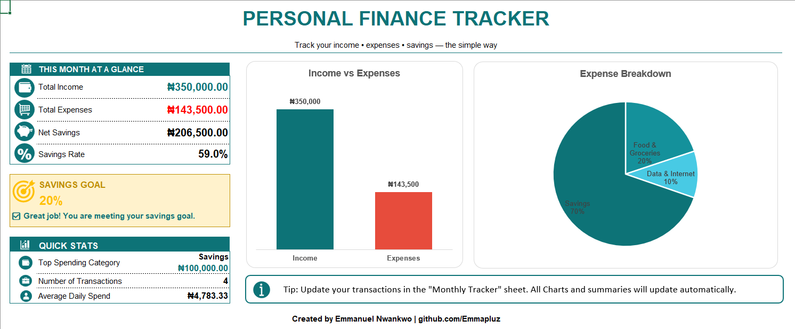

# Personal Finance Tracker — Excel Template

A free, practical Excel template built specifically for Nigerians.
Track your income, expenses, savings, and investments;
and forecast your finances 3 months ahead.

No accounting knowledge required.

---

## Preview

---

## What Is Inside

| Sheet | Purpose |
|---|---|
| **Dashboard** | At-a-glance view of income, expenses, net savings, savings rate and charts |
| **Monthly Tracker** | Log every transaction with date, category, type and amount |
| **Category Summary** | Budget vs Actual spending by category with status indicators |
| **3-Month Forecast** | Projects your income, expenses and savings for the next 3 months |
| **Instructions** | Step-by-step guide with Nigerian-specific tips |

---

## How to Use

1. Open the file in Microsoft Excel
2. Go to the **Monthly Tracker** sheet and select your Year and Month
3. Delete the sample data and enter your own transactions
4. Go to **Category Summary** and set your budget amounts (yellow cells)
5. Go to **3-Month Forecast** and set your Target Savings Rate (yellow cell)
6. Return to the **Dashboard** to see your live summary and charts

> **Yellow cells** = fields you can edit.
> All other cells contain formulas — do not overwrite them.

---

## Built For Nigerian Reality

Most finance templates are built for monthly rent, one income source,
and a standard savings account. This one is not.

This template correctly handles:

- **Yearly rent** — record the withdrawal from savings as income,
  then the rent payment as a Housing/Rent expense
- **Multiple income sources** — salary, side hustle, freelance,
  and other income tracked separately
- **Savings transfers** — money sent to PiggyVest, Cowrywise,
  Kuda, or any savings app is recorded as an Expense
  under the Savings category
- **Investment transfers** — money sent to ARM, Bamboo,
  Chaka, or any investment platform recorded as an Expense
  under the Investment category
- **Withdrawals from savings** — recorded as Income (Other Income) so your numbers stay accurate

---

## Categories Included

**Income:** Salary, Side Hustle, Other Income

**Expenses:** Food & Groceries, Transport, Housing / Rent,
Utilities & Bills, Data & Internet, Entertainment,
Healthcare, Personal Care, Savings, Investment, Others

---

## Download

Click the green **Code** button above and select **Download ZIP**,
or download the `.xlsx` file directly from this repository.

---

## About

Built by **Emmanuel Nwankwo**
Data Analyst & AI Automation Specialist

- GitHub: [github.com/Emmapluz](https://github.com/Emmapluz)
- LinkedIn: [linkedin.com/in/emmanuel-uchenna-nwankwo](https://linkedin.com/in/emmanuel-uchenna-nwankwo)
- Portfolio: [notion.so/Emmanuel-Nwankwo](https://www.notion.so/Emmanuel-Nwankwo-Data-AI-Automation-Portfolio-34d2848d0dba80bd9f6fc5fd419f3c63)

---

*Track wisely. Spend intentionally. Grow consistently.*
